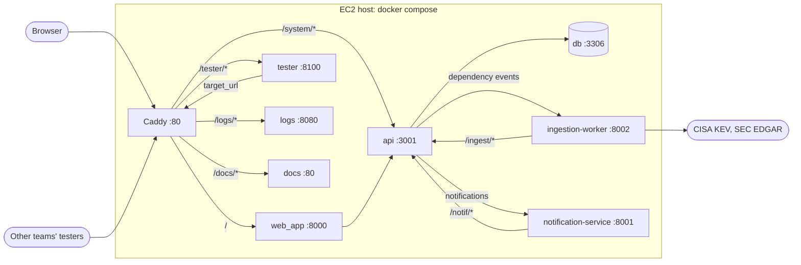
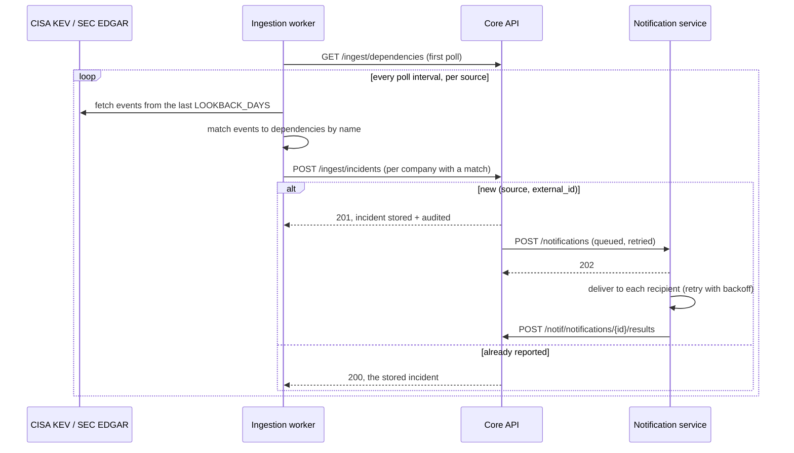

# Architecture

## Containers and who calls whom

The Core API is the hub. The other services never call each other: each one talks only to the
Core API, and it calls back the services that need to hear about changes.

## Routing (`Caddyfile`)

Caddy listens on port 80 with plain HTTP and is the only container that publishes a port. The
database's `127.0.0.1:3306` is for local tools only.

| Path | Container | Prefix stripped? | Why |
|---|---|---|---|
| `/system/*` | `api:3001` | Yes | `/system/health` reaches the API as `/health` |
| `/tester/*` | `tester:8100` | Yes | The tester's routes are at its root |
| `/logs*` | `logs:8080` | No | Dozzle runs with `DOZZLE_BASE=/logs`, so it expects the prefix. Behind `basic_auth` |
| `/docs` | none | n/a | Redirects to `/docs/` |
| `/docs/*` | `docs:80` | Yes | Static files; the site uses relative links |
| everything else | `web_app:8000` | n/a | The web app links to absolute paths (`/app/`, `/webapp/v1/...`), so it keeps the root |

The API, web app and tester all have their own `/health` or `/test/...` routes. That's why each
needs its own prefix instead of sharing the root.

## Service-to-service authentication

The pod's Core API endpoints (`/incidents`, `/tickets` and so on) take no credentials. Only the
endpoints between our own services are protected, each with a static bearer token from `.env`.
The tokens are compared in constant time.

| Caller → callee | Endpoints | Token |
|---|---|---|
| Ingestion worker → Core API | `/ingest/*` | `INGEST_CORE_API_TOKEN` |
| Core API → ingestion worker | `PUT`/`DELETE /dependencies/{id}` | `INGEST_INBOUND_TOKEN` |
| Notification service → Core API | `/notif/*` | `NOTIF_CORE_API_TOKEN` |
| Core API → notification service | `POST /notifications` | `NOTIF_INBOUND_TOKEN` |

The web app signs users in with a development placeholder, not real authentication (see
[Web app](services/web-app.md#sign-in)).

## Main flows

### Manual intake (web app)

1. `POST /webapp/v1/incidents`. If a dependency is named, the web app first checks it with
   `/dependencies MATCH`.
2. Core `/incidents NEW` (the web app generates a 12-digit `Incident_ID` if none is given).
3. Core `/tickets NEW`, writing an `INTAKE: ... by <user>` audit ticket.

A web app operation can make several Core calls, and they aren't atomic. If one fails partway,
the error lists `Completed_Steps`.

### Materiality decision (web app)

1. `PUT /webapp/v1/incidents/{id}/decision`, which needs a user in `decision_teams` (any user if
   that list is empty).
2. Core `/incidents EDIT` with the new Materiality, Severity and Urgency.
3. Core `/tickets NEW` with a `DECISION by <user>: ... Rationale: ...` ticket. The 8-K view
   reads these back later.
4. If Materiality changed to `MATERIAL`, Core `/notifier NOTIFY` for every configured team.
   This only records the notification in the database. It doesn't go through the
   notification service.

### Automatic intake (ingestion worker → notification service)

The worker doesn't remember what it reported. Each poll re-reports everything in its lookback
window, and the Core API's `(source, external_id)` uniqueness turns repeats into no-ops.

### Dependency sync (Core API → ingestion worker)

`/dependencies NEW` and `REMOVE` on the Core API also send `PUT` or `DELETE
/dependencies/{name}` to the worker, so its in-memory copy stays current between polls.
`/reset` and `/test/setup` send a `DELETE` for every dependency they wipe.

### Outbound calls from the Core API

The calls to the worker and notifier (`api/src/services.ts`) don't block the request that
caused them:

- They run in the background, one at a time per key: per dependency name, or per incident.
- Each is tried up to 5 times, waiting 2, 4, 8 and 16 seconds between tries.
- After the fifth failure, the call is logged with `console.error` and dropped.
- The queue is in memory, so a restart loses pending calls.
- If `WORKER_URL` or `NOTIFIER_URL` isn't set, the call is skipped.
