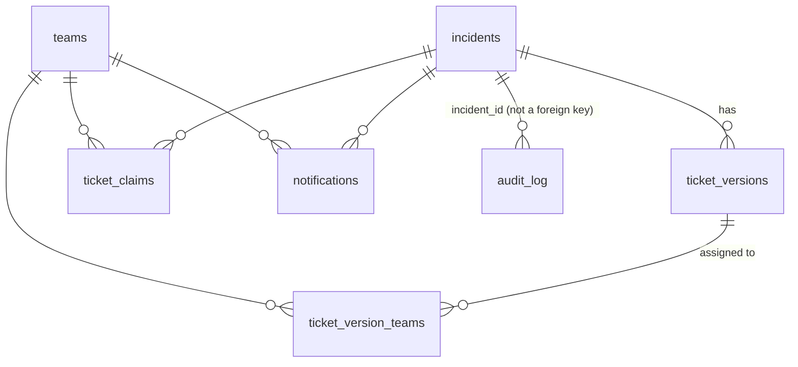

# Data model

The Core API owns all persistent data, in MySQL (`db/migrations/001_initial.sql`). The other
services keep only in-memory state; see [Known limitations](limitations.md).

## Domain concepts

**Incident.** Something that may have to be disclosed.

- **ID:** an `Incident_ID` of up to 64 characters with no `_`. The web app and Core API generate
  12-digit numbers.
- **Fields:** a description of up to 5000 characters, and an optional dependency name.
- **Decision fields:** three, each starting as `UNDECIDED`:
    - `Materiality`: `MATERIAL`, `IMMATERIAL` or `UNDECIDED`
    - `Severity`: `HIGH`, `MEDIUM`, `LOW`, `UNDECIDED` or `RESOLVED`
    - `Urgency`: `URGENT`, `NOT_URGENT`, `UNDECIDED` or `RESOLVED`
- **From the ingestion worker:** an incident it reported also stores `source`, `external_id` and
  the worker's full payload.

**Ticket.** A unit of work on an incident.

- **Numbers:** tickets are numbered 1, 2, … within their incident.
- **Versions:** tickets are append-only, so an edit inserts a new version instead of changing
  the old one.
- **Ticket IDs** come in two forms:
    - *weak* `<incident>_<ticket>`, e.g. `102356304331_2`, which names the ticket
    - *strong* `<incident>_<ticket>_<version>`, e.g. `102356304331_2_3`, which names one version
- **Version fields:** each version has its own description, severity, urgency and team list.
- **Edits:** an `EDIT` keeps the severity, urgency and teams it doesn't send.

**Claim.** One team takes ownership of a ticket.

- The current owner is the latest claim.
- A different team can't claim a ticket that's already claimed. The same team claiming it again
  succeeds and changes nothing.

**Notification.** A record that a team was told about a ticket (`/notifier NOTIFY`).

**Dependency.** A piece of software the company uses, identified by name alone (`dp_name`, up
to 255 characters). It is `MANUAL` when added through the API. The schema allows `AUTO`, but
nothing sets it yet.

**Team.** `LEGAL`, `CYBER1` and `CYBER2` are created by the migration and restored by every
reset. There is no API to add teams.

**Audit entry.** One row per read or write (see [the audit log](#audit-log)).

## Tables



| Table | Key | Notes |
|---|---|---|
| `incidents` | `incident_id` | `UNIQUE (source, external_id)` deduplicates ingested incidents. `ingest_json` is the worker's payload, returned on a repeat report |
| `ticket_versions` | `(incident_id, ticket_number, version)` | Append-only (triggers block `UPDATE` and `DELETE`) |
| `ticket_version_teams` | `(incident_id, ticket_number, version, team_name)` | The team list of each version. Append-only |
| `ticket_claims` | `claim_id` | Claim history. Append-only |
| `notifications` | `notification_id` | One row per team per `NOTIFY` |
| `dependencies` | `dp_name` | `source` is `MANUAL` or `AUTO` |
| `teams` | `team_name` | Seeded with the three default teams |
| `audit_log` | `seq` | Append-only and hash-chained |
| `audit_head` | `id = 1` | The tip of the chain (last `seq` and `hash`) |

All times are UTC, stored as `DATETIME(3)`.

New ticket numbers come from `MAX(ticket_number) + 1`, taken while holding a row lock on the
incident, so concurrent `NEW` calls on one incident queue up instead of colliding.

## Audit log

Every Core API database method writes an entry in the same transaction as the change,
**including reads** (`INCIDENT_READ`, `TICKET_READ`). The event types are:

- **Incidents:** `INCIDENT_CREATED`, `INCIDENT_EDITED`, `INCIDENT_READ`
- **Tickets:** `TICKET_CREATED`, `TICKET_EDITED`, `TICKET_READ`, `TICKET_CLAIMED`
- **Notifications:** `TEAMS_NOTIFIED`, `NOTIFICATION_SENT`, `NOTIFICATION_RESULTS`
- **Dependencies:** `DEPENDENCY_ADDED`, `DEPENDENCY_REMOVED`

Each entry is chained to the one before it:

```
hash = SHA-256(prev_hash + JSON([seq, occurred_at, incident_id, event_type, payload_json]))
```

The chain starts from 64 zeros. Each append locks the single `audit_head` row, so concurrent
writers queue up. Triggers block `UPDATE` and `DELETE` on `audit_log`. `TRUNCATE` still works,
and `/reset` relies on it.

`MySqlDb.verifyAuditChain()` re-hashes the whole chain and reports the first broken `seq`. No
endpoint exposes it, or the audit entries themselves, yet.

The `actor` column exists but is never filled in. The web app records who acted inside its
audit tickets' descriptions instead (`web_app/secheck_web/audit.py`):

```
INTAKE: incident created via manual intake by alice
EDIT: Description, Dependency_Name changed by bob
DECISION by carol: Materiality=MATERIAL; Severity=HIGH; Urgency=URGENT. Rationale: ...
```

## Payloads between services

The ingestion worker and notification service each define the payloads they exchange with the
Core API in their own `core_api.openapi.yaml`. Their Pydantic models (`models.py`) are generated
from it by `generate_models.sh`, so don't edit `models.py` by hand. The main shapes are:

| Schema | Fields | Meaning |
|---|---|---|
| `Dependency` | `id`, `company_id`, `vendor`, `product`, `version?`, `cpe?`, `purl?`, `vendor_cik?` | The worker's view of a dependency |
| `IncidentCreate` | `company_id`, `source`, `external_id`, `title`, `summary`, `source_url`, `published_at`, `detected_at`, `priority_hint`, `matched_dependencies[]`, `details` | A possible incident found by the worker |
| `MatchedDependency` | `dependency_id`, `vendor`, `product`, `version?`, `confidence`, `reason` | Why the worker thinks a dependency is affected |
| `NotificationRequest` | `notification_id`, `incident`, `claim_url`, `recipients[]` | What the Core API hands the notifier |
| `Recipient` | `recipient_id`, `team_name`, `channel`, `address` | One way to reach one team |
| `DeliveryResult` | `recipient_id`, `status`, `attempts`, `error?`, `delivered_at?` | What the notifier reports back. `status` is `delivered` or `failed` |

The enums are:

- `source`: `cisa_kev` or `sec_edgar_8k`
- `priority_hint`: `critical`, `high`, `medium` or `low`
- `confidence`: `high` or `medium`

### Mapping a dependency name for the worker

The Core API stores a dependency as a bare name, so it turns `dp_name` into the worker's
`Dependency` (`toWorkerDependency` in `api/src/services.ts`):

- If the name has a `:`, it splits there: `cisco:ios xe` becomes vendor `cisco`, product `ios xe`.
- Otherwise it splits at the first space: `Progress MOVEit Transfer` becomes vendor `Progress`,
  product `MOVEit Transfer`.
- A one-word name is both the vendor and the product.
- `company_id` is always `default`.
- `version`, `cpe`, `purl` and `vendor_cik` are always `null`. This means EDGAR's match by CIK
  can never fire for these dependencies.
