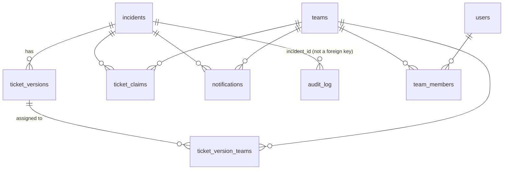

# Data model

The Core API owns all persistent data, in MySQL (`db/migrations/`). It applies each migration
once at startup and records it in `schema_migrations`. The other services keep only in-memory
state; see [Known limitations](limitations.md).

## Domain concepts

**Incident.** Something that may have to be disclosed.

- **ID:** an `Incident_ID`, any string of up to 64 characters (`_` allowed). The web app and Core
  API generate 12-digit numbers.
- **Fields:** a description of up to 5000 characters, and an optional dependency name.
- **Decision fields:** three, each starting as `UNDECIDED`:
    - `Materiality`: `MATERIAL`, `IMMATERIAL` or `UNDECIDED`
    - `Severity`: `HIGH`, `MEDIUM`, `LOW`, `UNDECIDED` or `RESOLVED`
    - `Urgency`: `URGENT`, `NOT_URGENT`, `UNDECIDED` or `RESOLVED`
- **From the ingestion worker:** an incident it reported also stores `source`, `external_id` and
  the worker's full payload.
- **Filing deadline:** the first time `Materiality` becomes `MATERIAL`, the incident records
  `material_at` and `filing_deadline`, 4 business days later (Form 8-K Item 1.05). Business days
  skip weekends and the holidays in `business_calendar`, counted on the New York date. The
  deadline is never restarted: changing away from `MATERIAL` needs a note and is audited as
  `MATERIALITY_REVERSED`, and becoming `MATERIAL` again keeps the first deadline.

**Ticket.** A unit of work on an incident.

- **Numbers:** tickets are numbered 1, 2, … within their incident.
- **Versions:** tickets are append-only, so an edit inserts a new version instead of changing
  the old one.
- **Ticket IDs** come in two forms:
    - *weak* `<incident>_<ticket>`, e.g. `102356304331_2`, which names the ticket
    - *strong* `<incident>_<ticket>_<version>`, e.g. `102356304331_2_3`, which names one version
- **Version fields:** each version has its own description, severity, urgency and team list.
- **Edits:** an `EDIT` keeps the severity, urgency and teams it doesn't send.

**Claim.** One team takes ownership of a ticket.

- The current owner is the latest claim.
- A different team can't claim a ticket that's already claimed. The same team claiming it again
  succeeds and changes nothing.

**Notification.** A record that a team was told about a ticket (`/notifier NOTIFY`).

**Dependency.** A piece of software the company uses, identified by name alone (`dp_name`, up
to 255 characters). It is `MANUAL` when added through the API. The schema allows `AUTO`, but
nothing sets it yet.

**Team.** `LEGAL`, `CYBER1` and `CYBER2` are created by the migration and restored by every
reset. `/teams` adds and removes teams and their members.

**User.** Someone who can act through the Core API (the `X-User` header), with a contact channel
and address for notifications. The defaults are the web app's development users (`alice`, `bob`,
`carol`, `dana`, `core-gateway`) and their teams; every reset restores them.

**Scope.** Which copy of the data a row belongs to: `scope_id` 0 is the real data, and each
cross-team test session gets its own scope (`test_sessions`). Every table except
`business_calendar`, `test_sessions` and `schema_migrations` has `scope_id` first in its key, so
sessions can use the same IDs without colliding.

**Audit entry.** One row per read or write (see [the audit log](#audit-log)).

## Tables



| Table | Key | Notes |
|---|---|---|
| `incidents` | `(scope_id, incident_id)` | `UNIQUE (scope_id, source, external_id)` deduplicates ingested incidents. `ingest_json` is the worker's payload, returned on a repeat report. `material_at` and `filing_deadline` are set at the first `MATERIAL` determination |
| `ticket_versions` | `(scope_id, incident_id, ticket_number, version)` | Append-only (triggers block `UPDATE` and `DELETE`) |
| `ticket_version_teams` | `(scope_id, incident_id, ticket_number, version, team_name)` | The team list of each version. Append-only |
| `ticket_claims` | `claim_id` | Claim history. Append-only |
| `notifications` | `notification_id` | One row per team per `NOTIFY` |
| `dependencies` | `(scope_id, dp_name)` | `source` is `MANUAL` or `AUTO` |
| `teams` | `(scope_id, team_name)` | Seeded with the three default teams |
| `users` | `(scope_id, username)` | `contact_channel` (default `log`) and `contact_address` (the contract's `Contact`) say where notifications go. `auth_hash` is the scrypt of the client's `Auth_Hash`, never returned |
| `team_members` | `(scope_id, team_name, username)` | Who is on which team |
| `audit_log` | `(scope_id, seq)` | Append-only and hash-chained, one chain per scope |
| `audit_head` | `scope_id` | The tip of each scope's chain (last `seq` and `hash`) |
| `business_calendar` | `day` | Days the SEC is closed besides weekends (US federal holidays, as observed), 2026 and 2027 |
| `test_sessions` | `scope_id` | One row per cross-team test session: its `session_id`, when it started, ended and was purged, and its stored report |
| `schema_migrations` | `name` | The migrations already applied |

All times are UTC, stored as `DATETIME(3)`.

New ticket numbers come from `MAX(ticket_number) + 1`, taken while holding a row lock on the
incident, so concurrent `NEW` calls on one incident queue up instead of colliding. Ticket edits
and claims take the same lock, so concurrent edits get distinct versions, and only one of two
teams claiming at once wins.

## Audit log

Every Core API database method writes an entry in the same transaction as the change,
**including reads** (`INCIDENT_READ`, `TICKET_READ`, `LOG_READ`). A `LIST` on `/incidents` or
`/tickets` writes one entry per call, not per row. The event types are:

- **Incidents:** `INCIDENT_CREATED`, `INCIDENT_EDITED`, `MATERIALITY_REVERSED`, `INCIDENT_READ`,
  `INCIDENTS_LISTED`. Edits record `before` and `after` for the changed fields, and the `note`
  when one was given.
- **Tickets:** `TICKET_CREATED`, `TICKET_EDITED`, `TICKET_READ`, `TICKET_CLAIMED`,
  `TICKETS_LISTED`
- **Logs:** `LOG_READ`
- **Notifications:** `TEAMS_NOTIFIED`, `NOTIFICATION_SENT`, `NOTIFICATION_RESULTS`
- **Dependencies:** `DEPENDENCY_ADDED`, `DEPENDENCY_REMOVED`
- **Teams and users:** `TEAM_CREATED`, `TEAM_REMOVED`, `TEAM_MEMBER_ADDED`,
  `TEAM_MEMBER_REMOVED`, `USER_CREATED`, `USER_EDITED`, `USER_REMOVED`

**`actor`** is who acted:

- the `X-User` header, which must be a user of that scope
- `ingestion-worker` or `notification-service`, from the token they called with
- `Unknown` otherwise

The web app sends the signed-in user as `X-User`. The web app's audit tickets still name the
user in their descriptions too (`web_app/secheck_web/audit.py`).

Each entry is chained to the one before it in its scope:

```
hash = SHA-256(prev_hash + JSON([seq, occurred_at, incident_id, event_type, payload_json, actor]))
```

`actor` is left out of the hash when it's `NULL`, so entries from before Phase 4 still verify.
The chain starts from 64 zeros. Each append locks its scope's `audit_head` row, so concurrent
writers queue up. Triggers block `UPDATE` on `audit_log`. They block `DELETE` too, unless the
connection has set `@seccheck_purge`, which only `/reset` and the purge of ended test sessions
do.

`/logs` returns an incident's audit entries as `Audit_Log`. `MySqlDb.verifyAuditChain()`
re-hashes a scope's chain and reports the first broken `seq`; no endpoint calls it yet.

## Payloads between services

The ingestion worker and notification service each define the payloads they exchange with the
Core API in their own `core_api.openapi.yaml`. Their Pydantic models (`models.py`) are generated
from it by `generate_models.sh`, so don't edit `models.py` by hand. The main shapes are:

| Schema | Fields | Meaning |
|---|---|---|
| `Dependency` | `id`, `company_id`, `vendor`, `product`, `version?`, `cpe?`, `purl?`, `vendor_cik?` | The worker's view of a dependency |
| `IncidentCreate` | `company_id`, `source`, `external_id`, `title`, `summary`, `source_url`, `published_at`, `detected_at`, `priority_hint`, `matched_dependencies[]`, `details` | A possible incident found by the worker |
| `MatchedDependency` | `dependency_id`, `vendor`, `product`, `version?`, `confidence`, `reason` | Why the worker thinks a dependency is affected |
| `NotificationRequest` | `notification_id`, `incident`, `claim_url`, `recipients[]` | What the Core API hands the notifier |
| `Recipient` | `recipient_id`, `team_name`, `channel`, `address` | One team member at their contact, or a team with no members in the log |
| `DeliveryResult` | `recipient_id`, `status`, `attempts`, `error?`, `delivered_at?` | What the notifier reports back. `status` is `delivered` or `failed` |

The enums are:

- `source`: `cisa_kev` or `sec_edgar_8k`
- `priority_hint`: `critical`, `high`, `medium` or `low`
- `confidence`: `high` or `medium`

### Mapping a dependency name for the worker

The Core API stores a dependency as a bare name, so it turns `dp_name` into the worker's
`Dependency` (`toWorkerDependency` in `api/src/services.ts`):

- If the name has a `:`, it splits there: `cisco:ios xe` becomes vendor `cisco`, product `ios xe`.
- Otherwise it splits at the first space: `Progress MOVEit Transfer` becomes vendor `Progress`,
  product `MOVEit Transfer`.
- A one-word name is both the vendor and the product.
- `company_id` is always `default`.
- `version`, `cpe`, `purl` and `vendor_cik` are always `null`. This means EDGAR's match by CIK
  can never fire for these dependencies.
