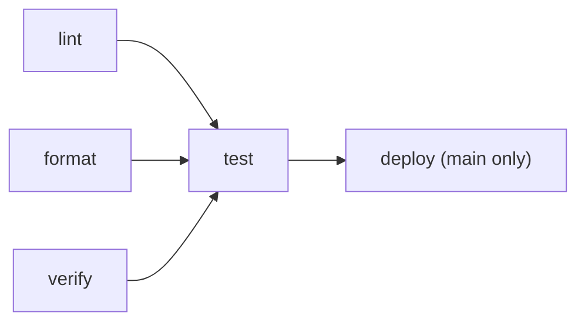

# Testing

## Test suites

| Suite | Where | Count | Needs |
|---|---|---|---|
| Tester self-tests | `tester/tests/` | 35 | Nothing. Runs against the tester's own mock system |
| Core API calendar tests | `api/test/calendar.test.ts` | 2 | Nothing |
| Core API Form 8-K tests | `api/test/form8k.test.ts` | 2 | Nothing |
| Core API coverage report tests | `api/test/coverage.test.ts` | 2 | Nothing |
| Core API database tests | `api/test/db.test.ts` | 31 | A MySQL it can wipe. Skips unless `DB_USER` is set |
| Core API HTTP tests | `api/test/api.test.ts` | 50 | A running Core API, wiped through `/reset`. Skips unless `API_URL` is set. The `/ingest` tests also need `INGEST_CORE_API_TOKEN` |
| Worker unit tests | `ingestion_worker/tests/test_matching.py`, `test_worker.py` | 31 | Nothing. The Core API and feeds are faked |
| Notifier unit tests | `notification_service/tests/` | 22 | Nothing. The Core API, SMTP and the Slack and Teams webhooks are faked |
| Worker and notifier end-to-end tests | `ingestion_worker/tests/test_e2e.py` | 6 | The whole stack with the worker and notifier, reading `mock_feeds.py` and emailing [Mailpit](https://mailpit.axllent.org/), a fake mail server (`docker-compose.e2e.yml`). Skips unless `E2E_SYSTEM_URL` is set; the email test also needs `E2E_MAILPIT_URL` |
| Cross-team suite | `tester/secheck_tester/suite.py` | 66 | The whole stack. Run through the tester against `/system` |

**Not covered by any test in this repo:**

- **Web app:** its tests (a mock Core API and unit tests) live in the pod's `Web Dev/` folder.
- **Ingestion worker and notification service:** only the code above. The feed parsers, EDGAR's
  filtering, the `log` channel and the notifier's report to the Core API have no unit tests.

## `./test.sh`

This runs everything, the same way CI does, against a throwaway stack:

- **Its own stack:** a separate compose project, `sec-check-test`, with its own containers and a fresh
  database. Your dev stack and its data aren't touched, and it can run while the dev stack is up.
- **Its own settings:** it reads `.env.example`, never `.env`.
- **Its own ports:** Caddy on `localhost:18080` and MySQL on `127.0.0.1:13306` (`HTTP_PORT` and
  `DB_HOST_PORT` in `docker-compose.yml`), not 80 and 3306. Mailpit's API is on `127.0.0.1:18025`.
- **Always removed:** when it finishes, passed, failed or interrupted, it runs `docker compose down -v`
  for that project. On a failure it first saves the container logs to
  `$TMPDIR/sec-check-test-compose.log` (`/tmp/...` by default), and prints them in CI.
- **One at a time:** it refuses to start while a `sec-check-test` stack exists. That's another run in
  progress, or one that was killed with no chance to clean up. Remove a stale one with
  `docker compose -p sec-check-test down -v`.

The steps:

1. Runs `docker compose up -d --build --wait db api tester caddy`, waits for `/system/health`,
   and opens the run's coverage window (below).
    - **Left out until step 3:** the ingestion worker and notification service. They would report
      incidents into the real data that the API tests use.
    - **Started anyway:** Caddy's dependencies (web app, log viewer, docs) start too. Building
      the docs this way also checks their links.
2. Runs the tester self-tests, the worker and notifier unit tests, then `npm test` in `api/` against
   `http://localhost:18080/system` and the database on `127.0.0.1:13306`.
3. Starts the worker, notifier, mock feeds and Mailpit. The worker reads the mock feeds, never the
   real ones.
4. Runs `tester/run_tests.py http://caddy/system --tester http://localhost:18080/tester`, which
   exits nonzero unless all 66 tests pass. It runs in its own test session, so the worker and
   notifier don't disturb it.
5. Runs `test_e2e.py`. Each of its tests resets the real data first.
6. Closes the coverage window and prints the run's total.

### Coverage

Only lines that requests run count, in all four services: not health checks, the worker's polling,
or answering `/coverage` (see [Core API](services/core-api.md#cross-team-testing-endpoints)).
There are two measures, and CI shows both in the job summary:

- **The cross-team suite's report:** what its one session reached. It calls only `/system`, and
  the notifier hears only of incidents the worker reports, so the web app, worker and notifier
  show as not reached.
- **The run's total:** a test session called `ci-total` that no request joins, open from step 1
  to step 6, so it counts every suite that calls the stack: the API tests, the cross-team suite
  and the end-to-end tests. The worker and notifier start after it opens; they count from when
  they started. It doesn't include the tests that import the code directly (the unit, database and
  tester self-tests), and nothing in CI uses the web app, so it shows as not reached.

## CI (`.github/workflows/ci.yml`)

- **lint:** runs `./lint.sh`: ruff for the Python services; `tsc` and Biome for the API.
- **verify:** runs the [verification checks](verification.md)' own tests (`architecture/tests/`),
  then `./verify.sh`.
- **format:** runs `./format.sh --check`.
- **test:** runs `./test.sh`, which uses `.env.example`'s throwaway secrets. If it fails, it
  prints the container logs.
- **deploy:** runs only on pushes to `main` (and manual runs on `main`), after `test` passes.
  See [Operations](operations.md#deployment).

Pull requests run lint, format and test.
