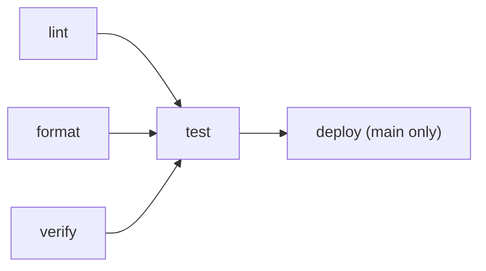

# Testing

## Test suites

| Suite | Where | Count | Needs |
|---|---|---|---|
| Tester self-tests | `tester/tests/` | 35 | Nothing. Runs against the tester's own mock system |
| Core API calendar tests | `api/test/calendar.test.ts` | 2 | Nothing |
| Core API database tests | `api/test/db.test.ts` | 28 | A MySQL it can wipe. Skips unless `DB_USER` is set |
| Core API HTTP tests | `api/test/api.test.ts` | 47 | A running Core API, wiped through `/reset`. Skips unless `API_URL` is set. The `/ingest` tests also need `INGEST_CORE_API_TOKEN` |
| Worker unit tests | `ingestion_worker/tests/test_matching.py`, `test_worker.py` | 26 | Nothing. The Core API and feeds are faked |
| Notifier unit tests | `notification_service/tests/` | 3 | Nothing |
| Worker end-to-end tests | `ingestion_worker/tests/test_e2e.py` | 5 | The whole stack with the worker and notifier, reading `mock_feeds.py` (`docker-compose.e2e.yml`). Skips unless `E2E_SYSTEM_URL` is set |
| Cross-team suite | `tester/secheck_tester/suite.py` | 70 | The whole stack. Run through the tester against `/system` |

**Not covered by any test in this repo:**

- **Web app:** its tests (a mock Core API and unit tests) live in the pod's `Web Dev/` folder.
- **Ingestion worker and notification service:** only the code above. The feed parsers, EDGAR's
  filtering, delivery channels and the notifier's API have no tests.

## `./test.sh`

This runs everything, the same way CI does:

1. Reads `.env`, which the API tests need for the DB credentials and ingest token.
2. Runs `docker compose up -d --build --wait db api tester caddy`, then waits for
   `/system/health`.
    - **Left out until step 5:** the ingestion worker and notification service. The worker would poll the
      real feeds, and could create incidents during the tests.
    - **Started anyway:** Caddy's dependencies (web app, log viewer, docs) start too. Building
      the docs this way also checks their links.
3. Runs the tester self-tests, the worker and notifier unit tests, then `npm test` in `api/` against `http://localhost/system` and
   the database on `127.0.0.1`.
4. Runs `tester/run_tests.py http://caddy/system --tester http://localhost/tester`, which
   exits nonzero unless all 70 tests pass.
5. Starts the worker, notifier and mock feeds, runs `test_e2e.py` against them, and removes them
   again. It runs last because those containers would report incidents during the other suites.

It **wipes your local database**. The cross-team suite runs in its own test session, so it
doesn't touch that data, and its report includes the Core API's code coverage and request
timings for the run (see [Core API](services/core-api.md#cross-team-testing-endpoints)).

## CI (`.github/workflows/ci.yml`)

- **lint:** runs `./lint.sh`: ruff for the Python services; `tsc` and Biome for the API.
- **verify:** runs the [verification checks](verification.md)' own tests (`architecture/tests/`),
  then `./verify.sh`.
- **format:** runs `./format.sh --check`.
- **test:** copies `.env.example` to `.env` (throwaway secrets for a throwaway stack) and runs
  `./test.sh`. If it fails, it prints `docker compose logs`.
- **deploy:** runs only on pushes to `main` (and manual runs on `main`), after `test` passes.
  See [Operations](operations.md#deployment).

Pull requests run lint, format and test.
