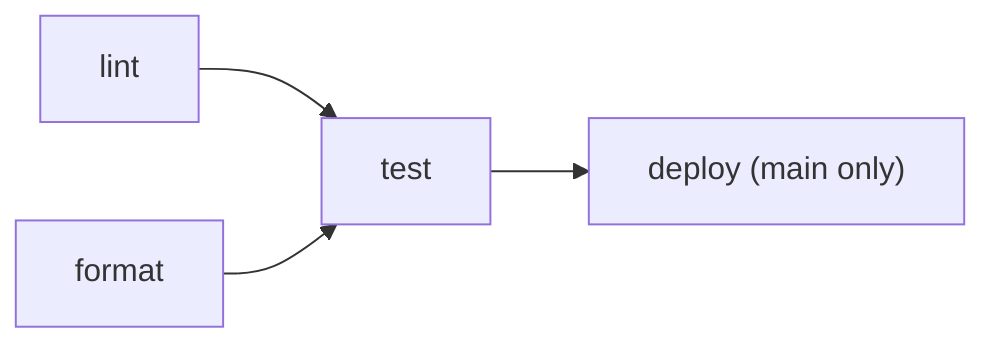

# Testing

## Test suites

| Suite | Where | Count | Needs |
|---|---|---|---|
| Tester self-tests | `tester/tests/` | 30 | Nothing. Runs against the tester's own mock system |
| Core API database tests | `api/test/db.test.ts` | 16 | A MySQL it can wipe. Skips unless `DB_USER` is set |
| Core API HTTP tests | `api/test/api.test.ts` | 20 | A running Core API, wiped through `/reset`. Skips unless `API_URL` is set. The `/ingest` tests also need `INGEST_CORE_API_TOKEN` |
| Cross-team suite | `tester/secheck_tester/suite.py` | 54 | The whole stack. Run through the tester against `/system` |

**Not covered by any test in this repo:**

- **Web app:** its tests (a mock Core API and unit tests) live in the pod's `Web Dev/` folder.
- **Ingestion worker and notification service:** no tests at all.

## `./test.sh`

This runs everything, the same way CI does:

1. Reads `.env`, which the API tests need for the DB credentials and ingest token.
2. Runs `docker compose up -d --build --wait db api tester caddy`, then waits for
   `/system/health`.
    - **Left out:** the ingestion worker and notification service. The worker would poll the
      real feeds, and could create incidents during the tests.
    - **Started anyway:** Caddy's dependencies (web app, log viewer, docs) start too. Building
      the docs this way also checks their links.
3. Runs the tester self-tests, then `npm test` in `api/` against `http://localhost/system` and
   the database on `127.0.0.1`.
4. Runs `tester/run_tests.py http://caddy/system --tester http://localhost/tester`, which
   exits nonzero unless all 54 tests pass.

It **wipes your local database**.

## CI (`.github/workflows/ci.yml`)

- **lint:** runs `./lint.sh`: ruff for the Python services; `tsc` and Biome for the API.
- **format:** runs `./format.sh --check`.
- **test:** copies `.env.example` to `.env` (throwaway secrets for a throwaway stack) and runs
  `./test.sh`. If it fails, it prints `docker compose logs`.
- **deploy:** runs only on pushes to `main` (and manual runs on `main`), after `test` passes.
  See [Operations](operations.md#deployment).

Pull requests run lint, format and test.
